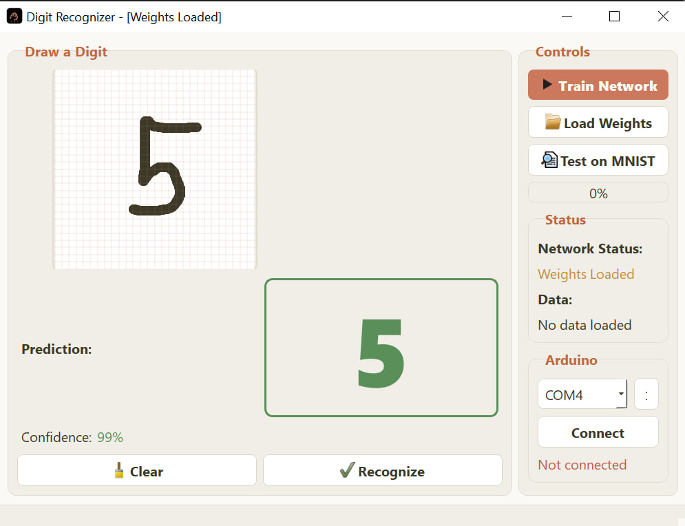

# mnist-mlp

A handwritten digit recogniser for Windows, built with C++, Qt 5.12.12 and Eigen. You draw a digit on the canvas, a neural network trained from scratch classifies it, and the result is mirrored onto an Arduino over a serial port.

## Preview

  

  <em>Inference with loaded weights: handwritten 5 → 5, 99% confidence.</em>

## About

The network is a multilayer perceptron, 784 → 256 → 10, implemented from scratch on top of Eigen: ReLU in the hidden layer, softmax over the ten digit classes, He initialisation, and stochastic gradient descent with momentum and L2 regularisation. Training runs on a worker thread, so the window stays responsive while the weights are updated, and the learning rate decays from 0.01 to 0.001 after the tenth epoch.

`Train Network` trains the network for 25 epochs on the training file and saves the result as `weights.bin`. `Load Weights` picks that file up instead of retraining. `Test on MNIST` measures the accuracy on the 10,000-sample test set and reports the number of correct and incorrect answers.

The drawing is not sent to the network as-is. The canvas is cropped to the bounding box of the strokes, scaled so that the longest side fits 20 pixels, and centred in a 28x28 frame by its centre of mass - the same preprocessing the original MNIST dataset went through.

The Arduino part is optional. The sketch in `arduino/DigitLeds` lights up as many LEDs as the digit the network has just recognised, and the window sends the digit over the serial port after every successful recognition.

> **Note:** The MNIST text files and the trained `weights.bin` are not in the repository. The program expects a training file at `resources/lib_MNIST_edit.txt` and a test file at `resources/lib_10k.txt`.

## How the code is organised

| File / directory | Responsibility |
| :-- | :-- |
| `main.cpp` | Application entry point |
| `MainWindow.h` / `MainWindow.cpp` | Window layout, user actions, training thread, serial port |
| `DrawingArea.h` / `DrawingArea.cpp` | Drawing canvas and conversion of the drawing into a 28x28 MNIST-style image |
| `NeuralNetwork.h` / `NeuralNetwork.cpp` | Multilayer perceptron: forward pass, backpropagation, weight updates |
| `Trainer.h` / `Trainer.cpp` | Training loop on a worker thread, learning-rate decay, progress signals |
| `DataLoader.h` / `DataLoader.cpp` | Reading the MNIST text files, normalisation and shuffling |
| `WeightsIO.h` / `WeightsIO.cpp` | Binary format of `weights.bin` |
| `NetworkConfig.h` | Network shape constants (784 inputs, 256 hidden units, 10 outputs) |
| `resources/` | Application icon and the MNIST data files |
| `extlibs/eigen/` | Eigen 5.0.0 headers (header-only, nothing to build) |
| `arduino/DigitLeds/DigitLeds.ino` | Arduino sketch that shows the digit on nine LEDs |
| `MNIST_MLP.slnx` / `MNIST_MLP.vcxproj` | Visual Studio solution and project settings |

## Controls

| Key / input | Action |
| :-- | :-- |
| Left mouse button on the canvas | Draw a digit |
| `Train Network` | Train the network; the same button stops training |
| `Load Weights` | Load `weights.bin` instead of training |
| `Test on MNIST` | Measure the accuracy on the 10,000-sample test set |
| `Recognize` | Classify the current drawing; runs automatically when the mouse button is released |
| `Clear` | Clear the canvas and reset the Arduino LEDs |
| `Connect` | Open the selected serial port and mirror recognised digits to the Arduino |

## Build and run

1. Install Visual Studio 2022 (or newer) with the **Desktop development with C++** workload and the **v141** build tools.
2. Set up **Qt 5.12.12 for MSVC 2017, x64** using Qt VS Tools. The project uses the Core, Gui, Widgets, and Serial Port modules. Eigen is already included in `extlibs/eigen`.
3. Get MNIST in text format: one sample per line, the first value is the label, followed by 784 pixel values (0-255). Save the training set as `MNIST_MLP/resources/lib_MNIST_edit.txt` and the 10,000-sample test set as `MNIST_MLP/resources/lib_10k.txt`.
4. Open `MNIST_MLP.slnx`, select **Release | x64**, then build and run with `F5`.
5. Optional Arduino part: open `arduino/DigitLeds/DigitLeds.ino` in the Arduino IDE, connect nine LEDs to pins D2-D10, upload the sketch, then select the port in the Arduino panel and press **Connect**.

> The project settings target the **v141** toolset and Windows SDK 10.0.26100.0, x64 only. `resources/` and `weights.bin` are resolved relative to the working directory, which is the project folder when you run the app from Visual Studio.

## Dependency

- Qt 5.12.12 for MSVC 2017, x64 — Core, Gui, Widgets, and Serial Port modules.
- [Eigen 5.0.0](https://gitlab.com/libeigen/eigen) — header-only linear algebra library; the headers are included in `extlibs/eigen`.

## License

MIT — see [LICENSE](LICENSE).

<b>🇷🇺 По-русски</b>

 

Распознавание рукописных цифр на C++ и Qt 5.12.12: вы рисуете цифру мышью, многослойный перцептрон (784 → 256 → 10), написанный с нуля на Eigen, её распознаёт, а результат уходит на Arduino — скетч зажигает столько светодиодов, сколько показывает цифра.

Сеть обучается стохастическим градиентным спуском с моментом и L2-регуляризацией; обучение идёт в отдельном потоке, по кнопке `Train Network` (25 эпох) веса сохраняются в `weights.bin`, а `Test on MNIST` считает точность на 10 000 тестовых примеров. Перед подачей в сеть рисунок обрезается по границам штрихов и центрируется в поле 28x28 — так же, как это сделано в самом MNIST.

Датасеты в репозиторий не входят: положите текстовые файлы `resources/lib_MNIST_edit.txt` (обучение) и `resources/lib_10k.txt` (тест), формат — метка и 784 значения пикселей в строке.

